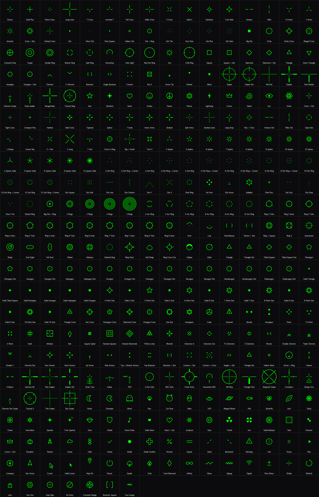

# NosCrosshair

A crosshair overlay for Windows: **358 crosshair styles** drawn in the exact centre of your screen, on top of your game. It is click-through, so it never gets in the way of your mouse.

## ⬇️ Download

**[Download NosCrosshair.zip](https://github.com/Nosrevis/NosCrosshair/releases/latest/download/NosCrosshair.zip)**

1. Right-click the zip and choose **Extract All...**
2. Double-click **Install.cmd** in the extracted folder. It installs for your user only (no admin needed) and adds Start menu and Desktop shortcuts.

Prefer not to install? Just run `NosCrosshair.exe` from any folder.

**"Windows protected your PC"?** NosCrosshair isn't code-signed, so SmartScreen may warn you the first time. Click **More info**, then **Run anyway**. The full source is in this repo if you want to check it or build it yourself.

## Features

- 358 crosshairs in 8 categories: Classic, Dots, Circles, Shapes, Geometric, Scopes, Fun and Symbols, plus your own PNG image
- Any colour, plus size, thickness, gap, outline (with its own colour), opacity, rotation and X/Y offset
- Live preview on different backgrounds
- Multi-monitor support
- Settings are saved automatically
- Runs in the system tray

## Hotkeys

| Key | Action |
| --- | --- |
| F8 | Show / hide the crosshair |
| F9 | Next crosshair |
| F7 | Previous crosshair |

## Requirements

- Windows 10 or 11 (nothing else to install)
- Play your game in **Windowed** or **Borderless Windowed** mode. Exclusive fullscreen draws over every overlay.

NosCrosshair only draws its own window on top of the screen. It never reads or changes game memory. Some competitive games still have rules about third-party overlays, so check the rules for the games you play.

## Build from source

No SDK needed. The C# compiler ships with Windows:

```powershell
powershell -ExecutionPolicy Bypass -File build.ps1          # build NosCrosshair.exe
powershell -ExecutionPolicy Bypass -File build.ps1 -Install # build and install
```

## All 358 crosshairs


